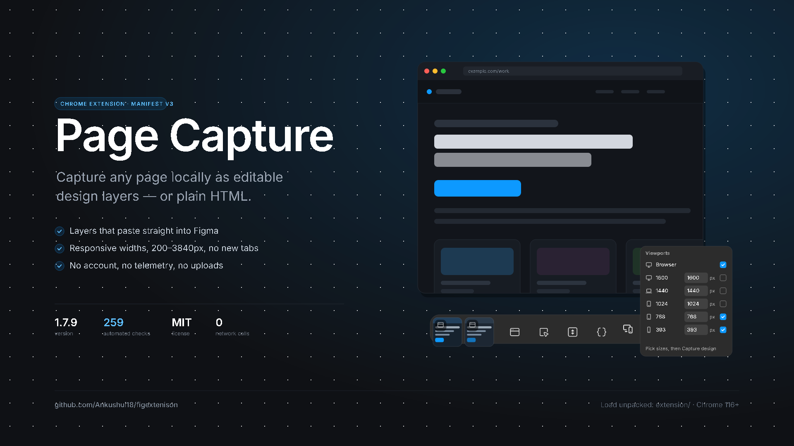
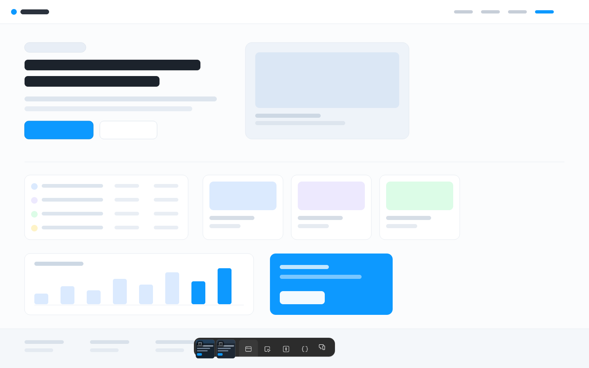
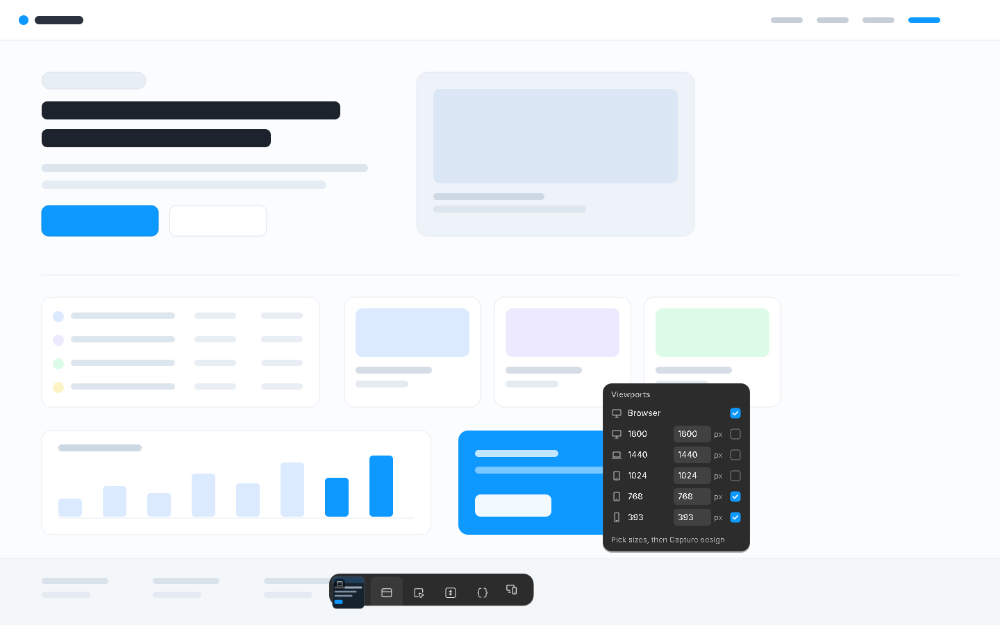
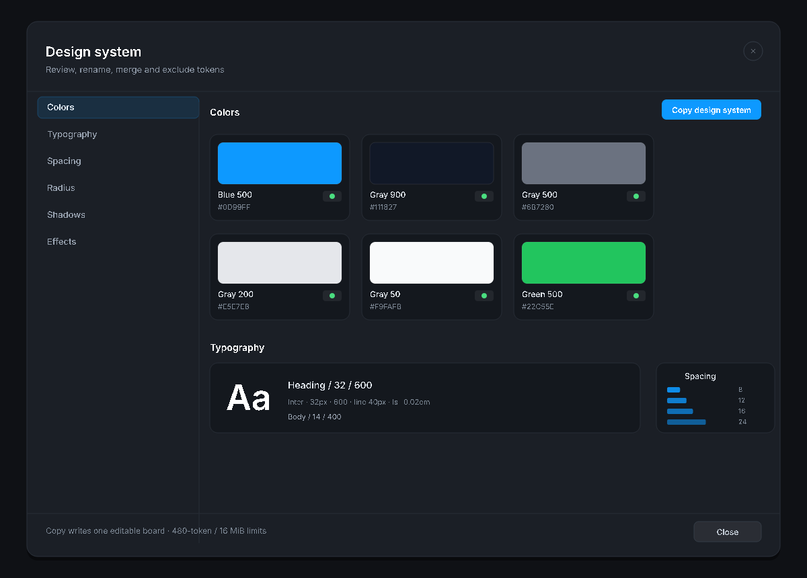
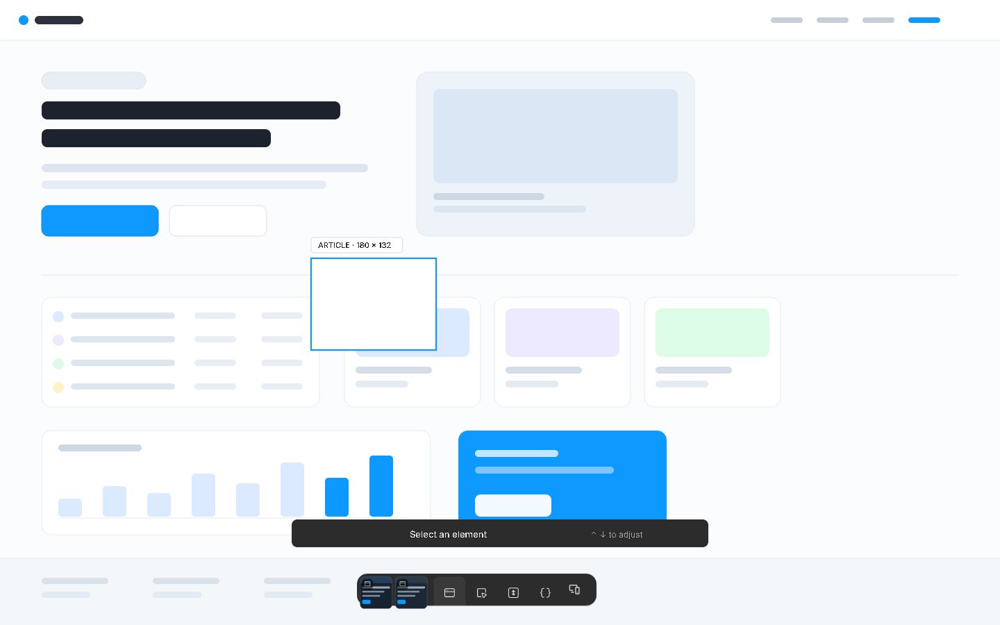
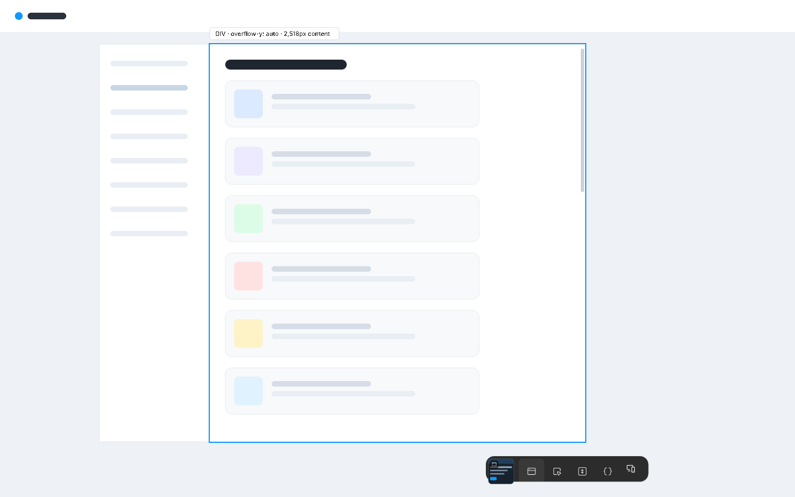
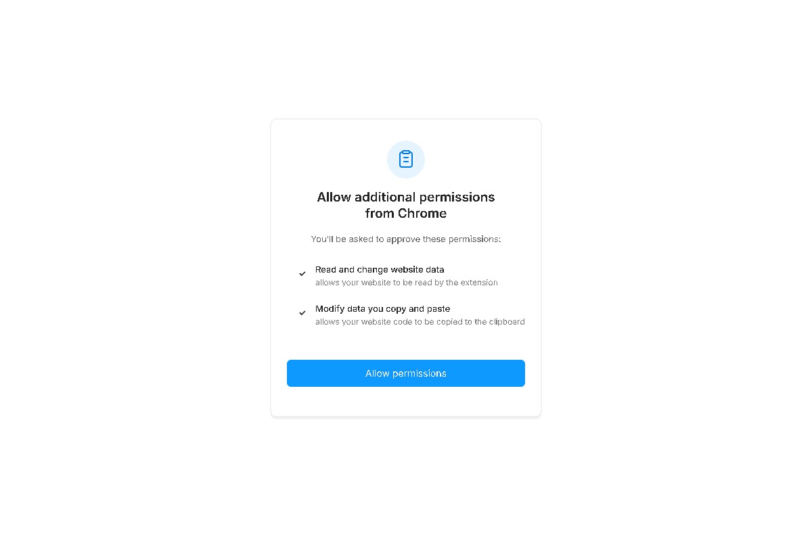

<p align="center"></p>

<h1 align="center">Page Capture</h1>

<p align="center"><b>A Chrome extension that copies a web page as editable Figma layers — locally.</b><br>
Full page, one element, one internal scroller, or several responsive widths.<br>
No account, no server, no telemetry, no uploads.</p>

<p align="center">
  <a href=".github/workflows/ci.yml"></a>
  
  
  
  
</p>

<p align="center">
  
  
  
</p>
<p align="center"><sub>One toolbar on any page · Responsive widths without new tabs · Design system review + copy · Page-to-wireframe</sub></p>

<p align="center">
  
  
  
</p>
<p align="center"><sub>Select one element · Capture a nested scroll area · Permissions explained before they are requested</sub></p>

<p align="center"><sub>Images are rendered from the extension's real styles, strings and icons, not screenshots of a live site — see <a href="docs/SCREENSHOTS.md">docs/SCREENSHOTS.md</a> for status and how to replace them.</sub></p>

---

## Start here

| I want to… | Go to |
|---|---|
| **Try it** (2 minutes) | [Install](#install-2-minutes) |
| **Understand what it does** | [What you get](#what-you-get) · [How a capture works](#how-a-capture-works) |
| **Capture several widths** | [Viewports](#viewports-responsive-widths) |
| **Capture a dashboard's inner scroller** | [Scroll area](#scroll-area) |
| **Get a design system out of a page** | [Design system](#design-system) |
| **Turn a page into a wireframe** | [Wireframe](#wireframe) |
| **Check the privacy claims** | [PRIVACY.md](PRIVACY.md) · [docs/PRIVACY-AUDIT.md](docs/PRIVACY-AUDIT.md) |
| **Understand or change the code** | [docs/ARCHITECTURE.md](docs/ARCHITECTURE.md) |
| **Run the tests / contribute** | [docs/TESTING.md](docs/TESTING.md) · [CONTRIBUTING.md](CONTRIBUTING.md) |
| **See what's missing** (honest list) | [Known limits](#known-limits) |
| **Fix a problem** | [docs/FAQ.md](docs/FAQ.md) |

> **Status: 1.9.0, source-distributed.** Not on the Chrome Web Store yet, so you
> load it from this folder. Everything runs in your browser.

> **Experimental, branch only.** This branch adds one **Canvas capture ON/OFF**
> switch to the toolbar. With it on, **Capture design** and **Select element** keep
> the page as editable layers and copy each canvas as one correctly cropped image
> (blank WebGL frames recovered, rasters scaled to Figma's 4096px limit). No canvas
> button can produce native Figma layers — that still needs Figma's own copy. It is
> not released and not merged. See [docs/CANVAS-RESEARCH.md](docs/CANVAS-RESEARCH.md).

---

## What it is, in one paragraph

Figma's rich clipboard format can carry a whole layout: frames, text, vectors and
image fills. This extension builds that format from a live page, so pasting into
Figma gives you **editable layers** instead of a screenshot. It also offers the
plain-HTML escape hatch (`Capture code`), responsive copies at chosen widths, and
an optional design-system pass that extracts colours, type, spacing, radii,
shadows and effects into a reviewable board. A **wireframe** mode rebuilds the
page as editable greyscale blocks at three fidelity levels, for when you need to
redesign the structure rather than reproduce the styling.

**Who it is for:** designers who want to pull a reference or a legacy screen into
Figma, engineers who need a page's actual DOM and assets, and anyone who needs a
capture without handing their browsing data to a service.

---

## What you get

| | |
|---|---|
| **Capture design** | Full page as editable layers, pasted from the rich clipboard. Handles `100%`-height roots, lazy images, video placeholders and open shadow roots. A canvas is rasterized honestly: cropped to its own box, WebGL read-backs included. |
| **Canvas capture** (experimental, this branch) | A toolbar switch beside **Capture design** / **Select element**. On: canvases copy as cropped, WebGL-safe images while the rest of the page stays editable layers. Off: exactly the previous behaviour. It never claims canvas layers, because a canvas has none. |
| **Import a Figma copy** | For content that only exists on a canvas. Select layers in Figma, `Ctrl/Cmd+C`, then import on the options page: the payload is kept locally and can be pasted into any file later. Optional clipboard read, only on click. This is the only route to true native layers, and it is deliberately not part of the capture flow. |
| **Select element** | Pick one element with the pointer; `↑`/`↓` adjust the selection. Produces the same editable model, scoped to that element. |
| **Capture scroll area** | Click *anywhere inside* a nested vertical scroller and capture its entire 2,000px+ content, not just the visible slice. |
| **Capture code** | Deliberately raw `document.documentElement.outerHTML`. No filtering — it is what it says. |
| **Viewports** | Check 1600 / 1440 / 1024 / 768 / 393 (editable, 200–3840px) and capture each width in one copy. No new tabs, no reloads, no resizing of the live page. |
| **Design system** | Extracts tokens in six categories, lets you rename, merge and exclude, then copies one editable reference board. |
| **Wireframe** | A check-box in the **Viewports** popover: tick it, pick **Low / Medium / High**, then **Capture design** as usual. The same copy writes greyscale, editable layers at every checked width — no screenshots, no images, no page CSS. |
| **Copy all / per-item copy** | The tray keeps captures per tab; copy one, several or everything, as design layers or as code. |
| **Honest feedback** | After a copy: "Copied to clipboard · Images: 12 included, 1 not embedded". Failures name themselves instead of silently truncating. |
| **Local everything** | `chrome.storage.local` for the tray, clipboard for output, nothing else. |

---

## Install (2 minutes)

**You need:** Chrome (or a Chromium browser) **116+** and this repository on disk.

1. **Get the files.**
   `git clone https://github.com/Ankushui18/figextenison.git`
   — or on GitHub **Code → Download ZIP** and unzip it. If you downloaded a
   release ZIP, unzip that instead.
2. **Open `chrome://extensions`** and turn on **Developer mode** (top right).
3. **Load unpacked** → select the **`extension/`** folder — the one that
   contains `manifest.json`, not the repository root.
4. **Open any page** and click the extension icon, or press the keyboard
   shortcut. The dark toolbar appears at the bottom of the page.
5. **First run asks for permissions.** Approve website access and clipboard
   write, or automatic copy is skipped and the tray stays available for manual
   copy. Reading the clipboard is a **separate, optional** ask that only the
   Figma-copy importer makes, and only when you press its button.

**No page handy?** Open `extension/options.html` directly in a browser to see the
permission card, or use the [FAQ](docs/FAQ.md).

### Updating

Replace the files in the same folder and click **Reload** on the extension card —
the extension ID stays the same. **Refresh any tab** that already had the toolbar
injected; injected code is only replaced on reload or navigation.

---

## How a capture works

```
click  →  inject 11 scripts  →  walk the DOM in rAF  →  resolve image sources
       →  expand the model (full page / scroll area)  →  serialize + bound the
          UTF-8 size  →  recover missing assets in batches of 64  →  store in the
          tab's tray  →  write one text/html clipboard payload on Copy
```

Two things are worth knowing:

- **Only the serialized model is expanded**, never the live page. A full-page or
  scroll-area capture does not scroll, resize or navigate anything you are
  looking at.
- **Nothing is truncated silently.** Every batch has a budget and a clear error
  instead of a partial paste.

| Limit | Value | Where |
|---|---|---|
| Responsive width | 200–3840px | `viewports.js` |
| Responsive height | 200–4000px | `viewports.js` |
| Nodes per responsive copy | 50,000 | `viewports.js` |
| CSS per responsive copy | 5 MiB | `viewports.js` |
| Rich batch | 48 MiB JSON / 64 MiB HTML | `capture-safety.js` |
| Design-system board | 16 MiB, 480 tokens, 200,000px tall | `design-system-board.js` |
| Wireframe | 20,000 layers, depth 60, 48-char ids, 2,000-char text, ±1,000,000px / 200,000px per side, 16 MiB copy budget | `wireframe-core.js`, `wireframe.js` |
| Asset recovery | 64 URLs per request, 10 MiB each, 5s | `background.js` |

Details: [docs/ARCHITECTURE.md](docs/ARCHITECTURE.md).

---

## Viewports (responsive widths)

Check the sizes you want, then **Capture design**. Extra widths are rendered from
the **current DOM** in an isolated, script-disabled frame at each width — so you
get real responsive reflow, not stretched duplicates.

- Media queries, container queries, viewport units, flex/grid and runtime CSSOM
  rules re-evaluate at the new width. Open shadow roots and adopted stylesheets
  are included.
- **JavaScript-only breakpoint rerenders are not replayed.** If a site builds its
  mobile layout in JS on resize, capture **Browser** only.
- **Exactly two screens?** Check two widths and uncheck **Browser**, so the
  current width is not also captured.
- Presets persist in `chrome.storage.local` and clamp to 200–3840px on load.

---

## Scroll area

Dashboards often hide their real height inside a nested scroller, so an ordinary
page capture stops at the visible slice.

**Capture scroll area** asks you to click a region; it resolves your click to the
nearest vertically scrollable ancestor (`overflow-y: auto | scroll | overlay`,
content taller than the box) and captures **that element's full content height**.
The page itself is never chosen, and a selection with no scrollable ancestor still
says *"Select an element with vertical overflow."*

If you are already scrolled halfway down, descendants are rebased so both the
first and last sections are present in one copy, and the captured width stays at
the current responsive width.

Not covered: infinite feeds, virtualized rows that only render on scroll, and
nested scrollers *inside* the chosen region.

---

## Design system

The generator reads the page's computed styles and groups what it finds:

| Category | Examples |
|---|---|
| Colors | fills, text colours, borders, gradients (normalised to one value each) |
| Typography | family, size, weight, line-height, letter-spacing, style |
| Spacing | margins and paddings, signed values retained |
| Radius | corner radii, including elliptical |
| Shadows | box-shadow and text-shadow |
| Effects | blur, filters, transforms |

You can rename, merge duplicates and exclude entries before copying. **Copy
design system** writes one editable board — colour swatches, type specimens,
spacing rulers — as the same rich clipboard format. Preparation is bounded
(12s, 480 tokens, 16 MiB) and cancelling removes the temporary frame.

This is a **reference board**, not a Figma variables import. It does not create
native variables or shared styles.

---

## Wireframe

Sometimes you do not want the page — you want its **skeleton**. Wireframe is not a
separate mode: it is a setting next to the width presets, so the copy you already
know produces it.

1. **Viewports** → tick **Copy as wireframe**.
2. Pick **Low**, **Medium** or **High**.
3. Press **Capture design** (or `Ctrl/Cmd + Enter`).

Every checked width is rebuilt — a wireframe at 1440 *and* 393 from one copy,
using the same rendering engine that produces responsive captures.

| Level | What it keeps | What it replaces |
|---|---|---|
| **Low · Skeleton** | Box geometry, section boundaries, layout | All text becomes grey bars; no radii, shadows, media or colour |
| **Medium · Structure** | Real text in a neutral typeface, real sizes and alignment | Colours flatten to greys by brightness, radii cap at 6px, images become labelled placeholders |
| **High · Detail** | The page's own font stack, type hierarchy, radii, border weights | Colour becomes a grey ramp that keeps dark sections dark, shadows are re-coloured, images stay placeholders |

How it works:

- **Same capture, different finish.** The page is captured exactly as it is today;
  the wireframe is produced from that capture just before it is encoded. The live
  page is never modified, and nothing is re-measured.
- **Structure survives.** Every box keeps its measured position and size. Clipped
  scrollers stay clipped, and fixed bars stay where the capture put them.
- **Interaction is the point.** Buttons, inputs and cards keep a 1px hairline so the
  wireframe reads as something you can click, not grey soup.
- **Scrims are not content.** A hover scrim or a gradient veil that covers a photo
  (and nothing else) is dropped instead of becoming a grey slab; a badge or a
  colour swatch of the same shape stays.
- **No assets.** Images, `background-image`, gradients, video, canvas, SVG artwork
  and cross-origin frames become vector placeholders labelled from `alt` or
  `aria-label`. No request is made and no image data is embedded.
- **No form values.** Inputs keep their box and placeholder text; typed values are
  never read into the payload.
- **Nothing the page hides.** A `display:none` menu, an `opacity:0` backdrop or a
  `visibility:hidden` label is dropped, so a wireframe cannot reveal copy the page
  keeps hidden.
- **Bounded, not surprising.** Layer ids, text runs and coordinates are clamped, and
  a copy that stops at the layer budget says so in the popover hint instead of
  arriving silently short.
- **Repeatable.** Copying the same capture twice produces byte-identical layers;
  the capture you were given is never edited.
- **Honest about itself.** The popover names the build (`Wireframe v1.9.0 · hook
  live`) and, after a copy, how many records it rebuilt. A copy that silently
  produced the page is flagged in red instead of reported as success.
- **Reversible.** The stored capture is untouched, so unchecking the option and
  copying again gives you the real page. The setting persists per browser profile,
  like the width presets.


*Left to right: **Low**, **Medium**, **High** — rendered through the real transform
by `scripts/wireframe-preview.js`. No page colour, image or font survives.*

The tray thumbnail still shows the original page, because that is what was
captured; the clipboard payload is the wireframe.

---

## Privacy, in one line

**The extension has no server.** Captures live in `chrome.storage.local` and your
clipboard; the only outbound requests are `GET`s for images the page already
references, with credentials omitted, referrers stripped, redirects rejected and
Figma/Sentry/private hosts blocked before `fetch`.

Full detail, including exactly what a capture can contain:
**[PRIVACY.md](PRIVACY.md)**. Per-release verification, including the counts:
**[docs/PRIVACY-AUDIT.md](docs/PRIVACY-AUDIT.md)**. Automated checks enforce these
claims on every push.

---

## Repository map

```
figextenison/
├── README.md                    ← you are here
├── extension/                   ← ONLY what Chrome loads. Load unpacked points here.
│   ├── manifest.json            MV3, Chrome 116+, 5 permissions + 1 optional
│   ├── options.html             permission / status page
│   ├── figma-import.html        "Import a Figma copy" page (optional clipboard read)
│   ├── js/
│   │   ├── background.js        service worker: 7 message handlers, injection
│   │   ├── core.js              shared constants, storage keys, options URL
│   │   ├── privacy.js           asset-URL policy (blocked hosts, private ranges)
│   │   ├── capture-safety.js    redaction, cancellation, budgets, clipboard prep
│   │   ├── viewports.js         responsive copies, lazy images, asset batches
│   │   ├── design-system-core.js  token extraction + review logic (pure)
│   │   ├── design-system-board.js editable board + clipboard payload
│   │   ├── design-system.js     the Design System panel
│   │   ├── wireframe-core.js    wireframe transform: levels, tones, bars (pure)
│   │   ├── wireframe.js         Viewports checkbox, saved choice, copy hook
│   │   ├── canvas-capture.js    WebGL-safe canvas raster, paste-size guard
│   │   ├── figma-clip.js        validate/store/re-emit a Figma `(figma)` copy
│   │   ├── figma-import.js      the Figma-copy importer page controller
│   │   ├── canvas-toggle.js     experimental Canvas capture ON/OFF switch
│   │   ├── h2d_toolbar.js       toolbar, capture engine, serializer, picker
│   │   └── options.js           options page controller
│   ├── font/, img/, _locales/, icon*.png
├── docs/
│   ├── ARCHITECTURE.md          which file owns what, message protocol, pipeline
│   ├── FAQ.md                   "is this a bug?" and how to verify privacy
│   ├── TESTING.md               unit + browser suites, fixtures, CI
│   ├── SCREENSHOTS.md           image status + how to retake them
│   ├── GITHUB_SETUP.md          repo settings, releases, upload mistakes
│   ├── PRIVACY-AUDIT.md         long-form privacy verification per release
│   ├── screenshots/             images used above
│   └── brand/                   icon, cover, social preview
├── tests/                       12 unit suites + 10 Chromium suites + fixtures
├── scripts/                     check-docs.js, pack.js
├── .github/workflows/ci.yml     what runs on every push and tag
├── CHANGELOG.md · CONTRIBUTING.md · PRIVACY.md · SECURITY.md · LICENSE (MIT)
```

**Rule of thumb:** `extension/` holds only runtime files. Documentation, tests and
scripts stay at the root. `npm run check` fails if that slips, because a
mis-placed upload is the most common way this repo breaks.

---

## Quality

```bash
npm test          # 356 dependency-free checks, no install, ~1s
npm run check     # version handshake, layout, docs links, quoted test counts
npm run verify    # check + test (what CI runs first)
npm run pack      # page-capture-<version>.zip from extension/
```

```bash
# optional: the real browser suites
npm install --no-save --package-lock=false playwright
npx playwright install chromium
npm run test:browser
```

Every push and pull request runs [CI](.github/workflows/ci.yml):

- **Version handshake** — `manifest.json`, `package.json` and `CHANGELOG.md` must
  agree, or the build fails.
- **Layout** — runtime files must be inside `extension/`, every injected script
  and manifest-referenced asset must exist.
- **Docs** — every relative link and image in the README and `docs/` must resolve.
- **Quoted counts can't drift** — the test count in the README, `docs/TESTING.md`
  and `CONTRIBUTING.md` is compared with what the suite actually ran.
- **356 unit checks** — privacy policy, redaction, cancellation, budgets,
  full-page/scroll-area normalisation, lazy images, viewport presets, token
  review, board payload, wireframe transform/options/clipboard hook, the
  experimental Canvas capture switch (state, persistence, raster notes,
  enabled/disabled matrix for both capture actions), locale coverage, no
  onboarding.
- **10 Chromium suites** — real toolbar injection, native rich clipboard payloads,
  real 1280/768/393px output, source DOM/scroll/focus preservation, denied-copy
  recovery, cancellation, zero remote requests from fixtures.

Full breakdown: [docs/TESTING.md](docs/TESTING.md).

---

## Known limits

An honest list. Most of these are browser or clipboard realities, not backlog.

- **Fidelity is not pixel-perfect.** Destination font substitution, unsupported
  CSS (some filters, masks, blend modes), embedded video frames and complex
  pseudo-element chains can differ after paste. The capture is data, not a
  screenshot, so the destination does the final rendering.
- **`Capture code` is raw.** No privacy filtering, no doctype, no offline assets,
  and it may include the injected toolbar host.
- **Lazy content that never rendered is not invented.** No infinite-feed
  scrolling, no "Load more" clicking, no virtualized rows.
- **Responsive copies do not replay JavaScript breakpoints.** See
  [Viewports](#viewports-responsive-widths).
- **Blocked assets stay blocked.** Figma-hosted, Sentry and private-address hosts
  are refused by policy; those images are reported as not embedded.
- **Pixels stay pixels.** A region painted into a `<canvas>` or WebGL — charts, maps, a
  video, or Figma's own editor — has no DOM below it, so it is captured as a single
  image fill rather than layers. Copying layers *between* Figma files is Figma's own
  `Ctrl/Cmd + C` → `Ctrl/Cmd + V`, not this extension. Every route in and out of that
  limit, with the evidence, is compared in
  [docs/CANVAS-RESEARCH.md](docs/CANVAS-RESEARCH.md).
- **A wireframe is a reconstruction, not the page.** Fonts are substituted except
  at High, JS-driven layout and CSS animations are not replayed, and anything that
  only exists as pixels (canvas, embedded frames, WebGL) becomes a placeholder.
  Text wrapping can shift slightly if the substitute font is wider. The tray
  thumbnail still shows the original page.
- **Clipboard writes are final once submitted.** Chrome cannot revoke a native
  write; cancel works up to that point.
- **No live Figma paste test.** Clipboard payloads are verified natively, but the
  final paste into Figma is a manual step and is not covered by CI.
- **Chromium only.** Edge usually works; Firefox and Safari are untested. The
  extension needs MV3 service workers, so Chrome 116+.
- **Store distribution is not set up.** This is source-distributed today.
- **A capture replaces whatever was on the clipboard.** If you had just copied
  layers inside Figma, paste them before capturing, or import the copy first —
  the capture writes its own payload over it.

---

## Troubleshooting

| Symptom | Likely cause |
|---|---|
| Toolbar never appears | Permissions not granted, or a `chrome://` / Web Store / `file://` page |
| Toolbar stale after update | Refresh the tab — injected code only changes on reload |
| Bottom of the page missing | Old build, or the content is inside a nested scroller → **Capture scroll area** |
| Responsive copy looks like a desktop | JS-driven layout; capture **Browser** only |
| Some images missing after paste | Blocked host, 404, or credentials required — see the "not embedded" count |
| A section pastes as one image, not layers | That region is painted into `<canvas>`/WebGL (charts, maps, video, Figma's own editor) — a canvas has no scene to describe, so it can only ever be pixels. Turn **Canvas capture** on to make that image correct (cropped, WebGL frame recovered); native layers need Figma's own copy |
| Copy does nothing | Clipboard write denied → use **Copy all** from the tray |
| Everything is slow on a huge page | Node/CSS budgets; capture a smaller section |
| Wireframe is empty or mostly blank | The page paints into canvas/WebGL, or the content is inside a cross-origin frame → uncheck **Copy as wireframe** and capture layers instead |
| Wireframed something by accident | Uncheck **Copy as wireframe** in **Viewports**; stored captures are untouched |
| Wireframe stops part-way | The popover hint says it hit the layer budget; capture a section instead |
| **Copy as wireframe** is greyed out | The capture pipeline was not found in this build; reload the extension |
| The copy came out as the real page | The popover's last line shows the loaded version and either *hook live* or *hook missing*. An older number means the loaded folder predates the fix — rebuild with `npm run pack` and load that folder |

More in [docs/FAQ.md](docs/FAQ.md).

---

## Contributing

Bug reports with a reproduction are the most valuable contribution. Read
[CONTRIBUTING.md](CONTRIBUTING.md) first, then
[docs/ARCHITECTURE.md](docs/ARCHITECTURE.md) to find the right file.

---

## License

[MIT](LICENSE) — free for personal and commercial use.

[Page Capture](https://github.com/Ankushui18/figextenison) is not affiliated with
Figma. Figma is a trademark of Figma, Inc.
